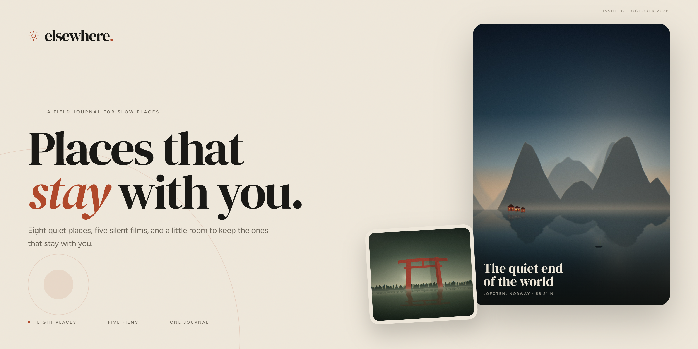
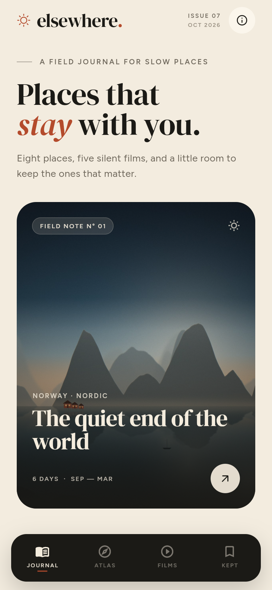
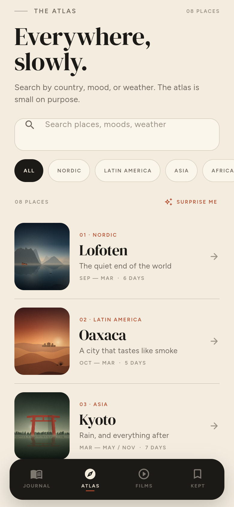
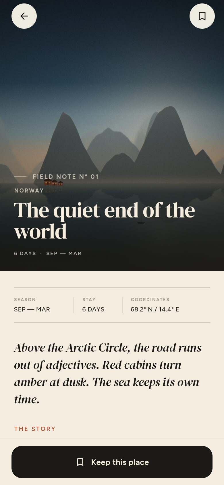
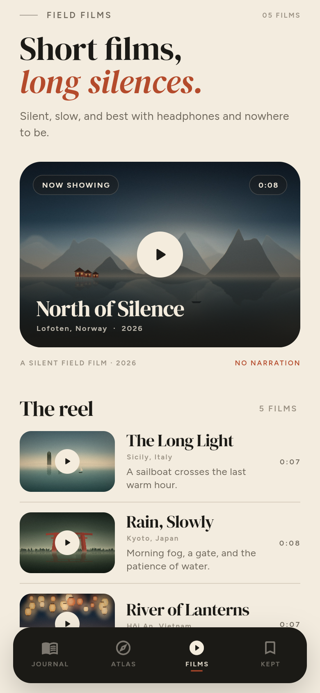
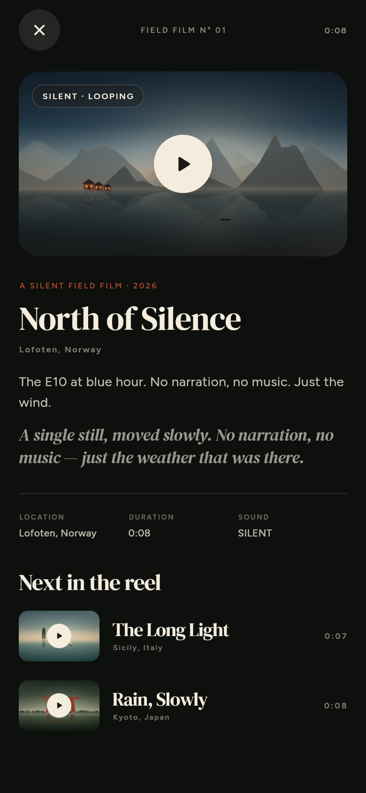
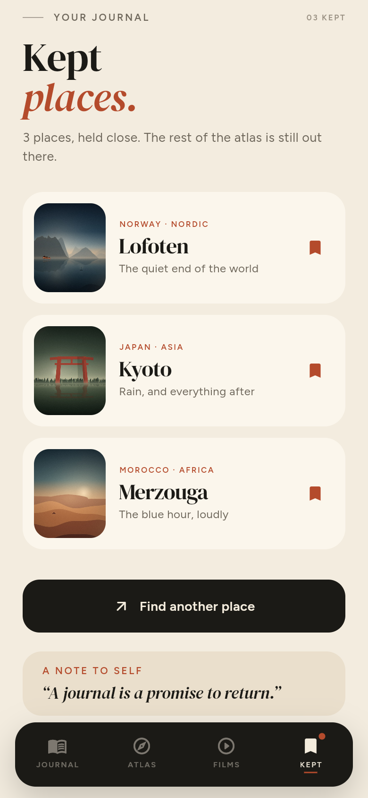
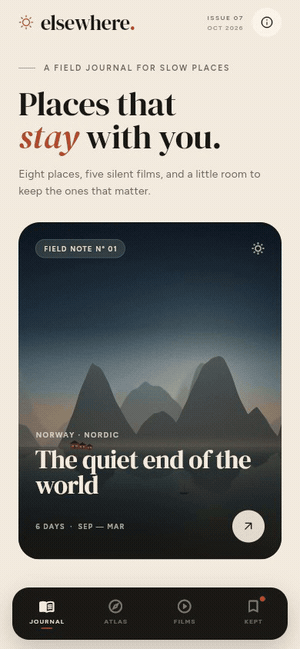

<p align="center">
  
</p>

<p align="center">
  <a href="https://tanimowoobaloluwadavid.github.io/elsewhere/"><strong>Open the live journal ↗</strong></a>
  &nbsp;&nbsp;·&nbsp;&nbsp;
  <a href="#the-journal">The journal</a>
  &nbsp;&nbsp;·&nbsp;&nbsp;
  <a href="#running-it">Running it</a>
  &nbsp;&nbsp;·&nbsp;&nbsp;
  <a href="#the-art-pipeline">The art pipeline</a>
</p>

<h3 align="center">A field journal for slow places — built with Flutter.</h3>

<p align="center">
  
  
  
  
  
</p>

---

**Elsewhere** is a small editorial travel journal. Eight destinations, five silent field films, a gallery for every place, and a private list of the ones that stay with you. No feed, no map, no account — just weather, type, and time.

Every still and film was generated for this project with a deterministic Python renderer, then bundled with the app. There are no network calls and no stock photography. Kept places live on the device.

<table>
  <tr>
    <td align="center"><br><sub><b>Journal</b> · an issue for slow reading</sub></td>
    <td align="center"><br><sub><b>Atlas</b> · eight places, one search</sub></td>
    <td align="center"><br><sub><b>Field note</b> · story, notes, gallery, film</sub></td>
  </tr>
  <tr>
    <td align="center"><br><sub><b>Films</b> · five silent shorts</sub></td>
    <td align="center"><br><sub><b>Player</b> · poster first, then slow motion</sub></td>
    <td align="center"><br><sub><b>Kept</b> · a journal that remembers</sub></td>
  </tr>
</table>

<p align="center">
  
  <br>
  <sub><b>In motion</b> · a quick walk through the journal</sub>
</p>

## The journal

- **Eight places, written as field notes.** Lofoten, Oaxaca, Kyoto, the Faroe Islands, Merzouga, Patagonia, Hội An, and Sicily. Each one has a story, three notes, a quote, coordinates, a three-image gallery, and a set of nearby places to wander toward.
- **Five silent films.** *North of Silence*, *The Long Light*, *Rain, Slowly*, *River of Lanterns*, and *Between Dunes*. Each film is a single still moved slowly, with grain and a long fade. There is no audio by design.
- **A player that respects the poster.** Films wait for a tap. The still comes first, the playback controls stay out of the way, and the next film is always one step down the page. Playback works on Android, iOS, macOS, and the web; Windows shows the still and a graceful note instead of a broken control.
- **An atlas you can search.** Query by country, mood, or weather — try “desert”, “rain”, “sea”, or “market”. Filter by region, or let **Surprise me** choose. The atlas is small on purpose.
- **A journal that stays put.** Tap *Keep this place* and it is written to local storage with `shared_preferences`. The Kept tab keeps the order you collected them in, shows a badge on the nav, and lets you clear the journal whenever you like.
- **Made to be looked at.** DM Serif Display and Figtree on warm paper, ink, and clay. Staggered fade-and-rise motion, editorial cards, a custom floating nav, a full-screen viewer, and a paper-grain finish. Responsive from a 390 px phone to a wide desktop.

> “A journal is a promise to return.”

## Running it

**Requirements:** Flutter 3.41 or newer (Dart 3.11). The project targets Android, iOS, web, and Windows.

```bash
flutter pub get
flutter run -d chrome        # or: -d windows, -d android, -d ios
```

Build for the web:

```bash
flutter build web --release --base-href /elsewhere/
```

The app is deployed to GitHub Pages by [`.github/workflows/deploy.yml`](.github/workflows/deploy.yml) on every push to `main`. CI runs `flutter analyze`, `flutter test`, and a release web build on every push and pull request.

You can also open a specific screen for screenshots or sharing with query parameters on the web:

```
?screen=journal | explore | films | saved
?place=lofoten
?film=north-of-silence
?saved=1
```

## The art pipeline

The stills, icon, splash mark, and films are all generated locally. The renderer uses seeded randomness, hand-built scene functions, and the same fonts that ship with the app. Nothing is downloaded at runtime.

```bash
python -m pip install pillow numpy imageio-ffmpeg
python tool/generate_assets.py     # 24 stills + icon + grain
python tool/generate_videos.py     # five silent 720p films

npm --prefix tool/shots install
node tool/shots/banner.mjs         # README banner (Playwright + Chrome)
node tool/shots/screens.mjs        # 390 × 844 screenshots
node tool/shots/demo.mjs           # an interaction clip for the GIF
python tool/make_demo_gif.py       # clip → docs/demo.gif
```

The generated media is committed, so a fresh clone needs none of this to run. The scripts are included for anyone who wants to remix the journal.

## Project structure

```
lib/
  core/       palette, type scale, reveal motion, routes
  data/       the eight places and five films
  models/     Place, FieldNote, FieldFilm
  screens/    journal, atlas, place, films, player, kept, photo viewer
  state/      the persisted saved journal
  widgets/    editorial primitives, cards, nav, about sheet
tool/         asset + film renderers, screenshot harness
assets/       stills, films, fonts, icon, splash mark
```

## Credits

- **Type:** [DM Serif Display](https://fonts.google.com/specimen/DM+Serif+Display) and [Figtree](https://fonts.google.com/specimen/Figtree), both under the SIL Open Font License. The licenses are bundled in `assets/fonts/`.
- **Flutter packages:** `provider`, `shared_preferences`, and `video_player`, with `flutter_launcher_icons` and `flutter_native_splash` for the app shell.
- **Art and words:** generated and written for Elsewhere. The destinations are real; the trips, captions, and field notes are fiction. The coordinates are approximate, and the light is invented.

Made for the quiet part of the journey. [MIT licensed](LICENSE) © 2026 Tanimowo Obaloluwa.
